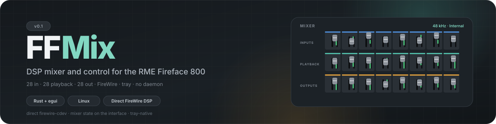
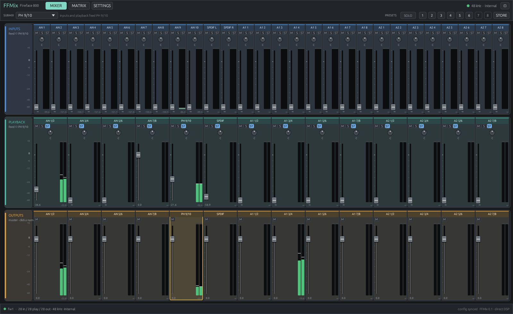
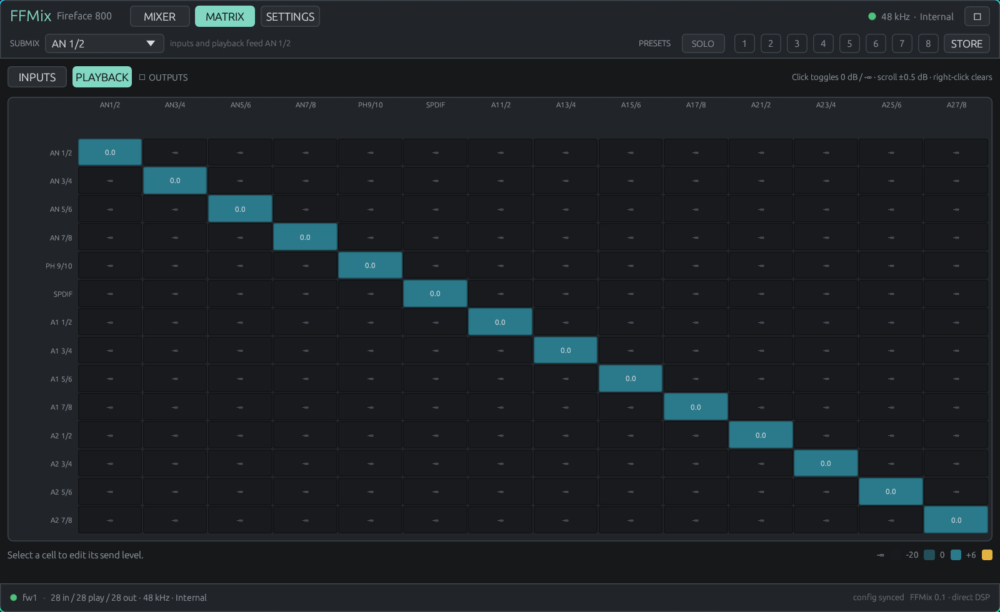
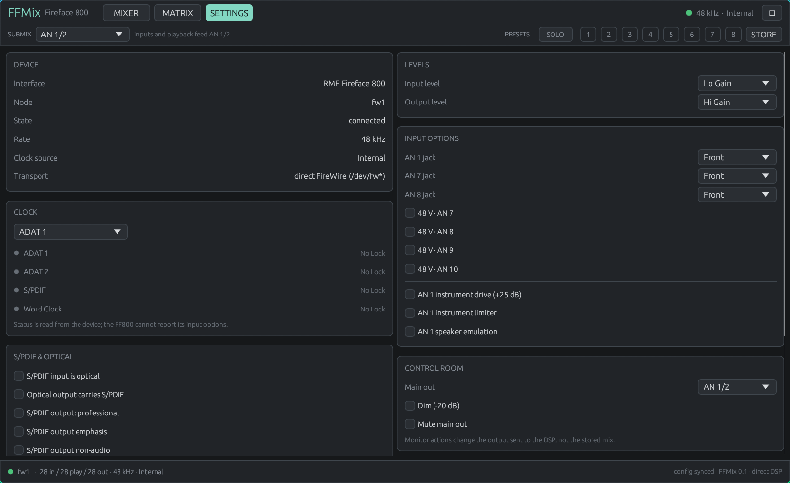
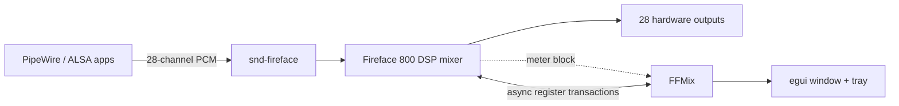

<p align="center">
  
</p>

<p align="center">
  <a href="https://github.com/hansfbaier/ffmix"></a>
  
  
  
  <a href="LICENSE"></a>
</p>

<p align="center">
  <b>Native DSP mixing for the RME Fireface 800 on Linux.</b><br>
  Controls the interface's own mixer over FireWire, so monitoring has no added latency and<br>
  the mix keeps running when the window is closed. No ffado, JACK, or helper daemon.
</p>

> **Not affiliated with RME.** FFMix is an independent interoperability project and is
> not endorsed by, sponsored by, or connected to RME. “Fireface” and “TotalMix” are
> trademarks of RME. This repository contains no RME source code, firmware, binaries,
> installer contents, or TotalMix FX artwork; it implements the interface's register
> behavior independently. The only reused implementation code is MIT-licensed
> [Openface Mixer](https://github.com/thomas-nelson23/Openface-Mixer).

---

<p align="center">
  <a href="docs/screenshots/mixer.png"></a>
</p>

<p align="center"><sub><b>Mixer</b> — select an output, then mix every input and playback channel into it. Real hardware meters, peak hold, fader groups, stereo links and presets.</sub></p>

<table>
  <tr>
    <td width="50%"><a href="docs/screenshots/matrix.png"></a></td>
    <td width="50%"><a href="docs/screenshots/settings.png"></a></td>
  </tr>
  <tr>
    <td align="center"><sub><b>Matrix</b> — 14 × 14 crosspoints with live source/output rails and crosspoint activity; click, scroll or use the keyboard.</sub></td>
    <td align="center"><sub><b>Settings</b> — clock, optical/S-PDIF routing, levels, jacks, 48 V, instrument options and control-room monitoring.</sub></td>
  </tr>
</table>

## Why FFMix

Most Linux FireWire workflows either expose only the ALSA card or require a separate
mixer service. FFMix takes the direct route: it opens the Fireface's FireWire node and
writes the same DSP coefficients TotalMix uses, while ALSA/PipeWire keeps handling the
audio stream. The result is a native, low-latency monitor mix with no software audio
path and no daemon to keep alive.

| | |
| --- | --- |
| **Direct DSP control** | Mixer, output masters and settings are written straight to the interface over `/dev/fw*`. |
| **TotalMix workflow** | Hardware inputs, playback and outputs in three rows; click an output to edit its submix. |
| **Real meters** | Input, playback and output levels are read from the interface's meter block, with peak hold and clip indication. The matrix adds live source/output rails and crosspoint activity. |
| **Everything at hand** | Matrix, 8 presets, fader groups, stereo links, device settings and a tray icon in one small binary. |
| **Safe coexistence** | Refuses to fight Openface Mixer or `snd-fireface-ctl-service`; tells you exactly what is running. |

## Quick start

```sh
git clone https://github.com/hansfbaier/ffmix.git
cd ffmix
cargo build --release
./target/release/ffmix
```

Or install the binary:

```sh
cargo install --path .
ffmix
```

You need a Rust toolchain, Linux `firewire-core`, and permission to open the Fireface's
`/dev/fw*` node (normally your user is in the `audio` group).

### Arch Linux package

A `PKGBUILD` and generated `.SRCINFO` live in [`packaging/arch`](packaging/arch):

```sh
cd packaging/arch
makepkg -si
```

The package installs the binary, desktop entry, icon, license and documentation. A
prebuilt `ffmix-0.1.1-1-x86_64.pkg.tar.zst` is attached to the
[v0.1.1 release](https://github.com/hansfbaier/ffmix/releases/tag/v0.1.1).

<details>
<summary><b>Build dependencies</b></summary>

FFMix uses egui/eframe (glow, X11/Wayland) and ksni (libdbus). Typical packages:

```sh
# Arch
sudo pacman -S --needed base-devel rust dbus libx11 libxcursor libxrandr libxi \
  wayland libxkbcommon mesa

# Debian / Ubuntu
sudo apt install build-essential pkg-config libdbus-1-dev libx11-dev libxcursor-dev \
  libxrandr-dev libxi-dev libwayland-dev libxkbcommon-dev libgl1-mesa-dev
```

</details>

<details>
<summary><b>Start hidden in the tray at login</b></summary>

```sh
mkdir -p ~/.config/autostart
cat > ~/.config/autostart/ffmix.desktop <<'EOF'
[Desktop Entry]
Type=Application
Name=FFMix
Comment=Fireface 800 DSP mixer
Exec=ffmix --minimized
Terminal=false
X-GNOME-Autostart-enabled=true
EOF
```

Close the window to hide it; use the tray icon to restore. `Ctrl+Q` or the tray menu
quits.

</details>

## The mixer

- **Submix workflow** — click an output strip to select it. Input and playback faders
  then set each source's send into that output pair. The top bar's **SUBMIX** combo
  does the same from the keyboard.
- **28 × 28 × 28** — 28 hardware inputs, 28 playback channels, 28 outputs (14 stereo
  pairs). Inputs are mono strips; playback and outputs start stereo-linked.
- **Pan, mute, solo, stereo link** — per-source pan and mute are folded into the gain
  matrix; solo is solo-in-place in the selected submix, like TotalMix.
- **Meters** — real hardware values with 26 dB/s release, 1.5 s peak hold, numeric peak
  readout and clip LEDs. Click a meter to reset its peak.
- **Fader groups** — right-click a strip and assign one of four groups; grouped faders
  follow relative dB moves.
- **Presets** — eight slots. `F1`…`F8` recall, `Shift+F1`…`F8` store, or use the
  **STORE** button and the lit slot buttons. Presets live in JSON and contain the mix,
  not the device configuration.
- **Matrix** — inputs → outputs and playback → outputs, 14 × 14 cells. Click toggles
  between 0 dB and -∞, scroll adjusts ±0.5 dB, right-click clears. Arrow keys move the
  selection, `Enter` toggles, `Backspace` clears, `+`/`-` trim. Rows are sources and
  columns are outputs, as in TotalMix. Rows meter sources, columns meter outputs, and
  active cells glow and grow a bottom activity bed; hover any cell for source, send,
  crosspoint and output dBFS.

### Matrix metering

The matrix is also a live display. A thin bar under each column head shows that output
pair's post-master level, and a vertical bar beside each row shows that source pair's
level; both include peak hold and clip caps. Each crosspoint tints and grows a bottom
activity bar from the source level times its actual routed gain, with mute, solo, pan
and stereo links folded in, so the signal visibly travels from the active column into
the routed cells. Click a rail to reset its peak.

The FF800 meter block exposes per-channel levels, not per-crosspoint taps, so the cell
reading is a pre-master estimate rather than a separate hardware measurement. The row
rail remains the real output level. Leaving the estimate pre-master means routing stays
visible even when an output is muted.

## Device settings

The FF800's configuration register is write-only. FFMix therefore keeps its own copy
and writes it on connect: clock source, S/PDIF input coax/optical, optical output
ADAT/S-PDIF, professional/emphasis/non-audio flags, word clock single-speed, input and
output levels, AN 1/7/8 front/rear jacks, 48 V on AN 7–10, and AN 1 instrument
drive/limiter/speaker emulation.

The status register is read live: sample rate, active clock source, and lock/sync state
for ADAT 1/2, S/PDIF and word clock. The settings file is in
`~/.config/ffmix/settings.json`.

## Controls

| Action | Input |
| --- | --- |
| Select submix | Click an output strip, or use the **SUBMIX** combo |
| Fader | Drag; `Ctrl` = fine; double-click or `Alt`+click = 0 dB; wheel = ±1 dB |
| Pan | Drag the knob; double-click = centre; wheel |
| Mute / Solo | `M` / `S` on a strip |
| Stereo link | `ST` on input/playback strips |
| Fader group | Right-click a strip → Fader group 1–4 |
| Preset recall / store | `F1`…`F8` / `Shift+F1`…`F8` |
| Mixer / Matrix / Settings | `Ctrl+1` / `Ctrl+2` / `Ctrl+3` |
| Main-out volume | `Ctrl+Shift+↑` / `Ctrl+Shift+↓` |
| Main-out mute / 0 dB | `Ctrl+Shift+M` / `Ctrl+Shift+0` |
| Previous / next submix | `Ctrl+Shift+←` / `Ctrl+Shift+→` |
| Reset a matrix rail peak | Click the source or output rail meter |
| Reset all peaks | `Ctrl+Shift+R` |
| Quit | Tray → Quit, `Ctrl+Q`, or ⋯ → Quit |

## How it works



Audio never passes through FFMix. The application opens the interface's FireWire node
and uses asynchronous firewire-cdev transactions to write the mixer blocks, output
masters and configuration words, and to read status and meters. The 20 ms worker
writes only changed blocks; a 30 ms meter read keeps the display live.

### Register interface

| Register | Use |
| --- | --- |
| `0x000080080000` | mixer: 64 quadlets per output (28 inputs at 0–27, playback at 32–59) |
| `0x000080081f80` | output volumes, one quadlet per output |
| `0x0000fc88f014` | configuration, three quadlets (write-only) |
| `0x0000801c0000` | status, two quadlets |
| `0x000080100000` | meters, 1008 bytes |

All values are little-endian. Gains are linear × `0x8000` (0 = off, `0x8000` = unity,
`0x10000` = +6 dB); output masters use the same encoding. The meter block's last 84
quadlets are input, playback and output amplitudes, full scale `0x7fffff00`.

## Verified on

| | |
| --- | --- |
| Host | Linux 6.18.57, Hyprland (XWayland), Rust 1.99 |
| Interface | RME Fireface 800, FireWire node `/dev/fw1`, 48 kHz internal clock |
| Audio | PipeWire playback through the DSP; hardware output meters respond to routed signal |
| Matrix live | Source/output rails, peak hold, cell activity and hover dBFS verified with a routed test tone |
| Mixer | Submix routing, output gain changes, mute, matrix cell edits, presets |
| Settings | Configuration bits verified by reading the status register back |
| Tray | StatusNotifierItem menu, mute-all, hide/show, close-to-tray, `--minimized`, quit |

## One mixer controller at a time

The Fireface has a single DSP mixer. Do not run another program that writes the same
registers while FFMix is open:

- **Openface Mixer** (`openface-mixer-engine@ff800.service`) — stop and disable it:
  `systemctl --user disable --now openface-mixer-engine@ff800.service`
- **snd-fireface-ctl-service** (snd-firewire-ctl-services) — stop/disable it as well.
- **ffado-mixer**, an old TotalMix instance, or `snd-fireface-ctl-service` may overwrite
  FFMix's coefficients. `ffado-dbus-server` itself is passive and harmless.

FFMix detects the first two and refuses to open the device rather than fighting them.
The warning banner and the **DEVICE** card in Settings have **Stop now** and
**Disable at login** buttons. `FFMIX_ALLOW_CONFLICT=1` bypasses the check (not advised).

### Wayland and the tray

winit cannot hide or unhide a native Wayland window, which would break close-to-tray.
FFMix therefore runs as an **X11/XWayland** client by default when `DISPLAY` is
available. Set `FFMIX_NATIVE_WAYLAND=1` to keep the native Wayland backend; in that mode
the window cannot be restored from the tray after hiding.

## Project layout

```text
src/
  main.rs      CLI, single-instance lock, X11 preference, eframe bootstrap
  app.rs       egui views: mixer, matrix, settings, presets, tray commands
  model.rs     mix model, sends/pan/mute/solo, fader taper, channel naming
  ff800.rs     FF800 register interface, settings words, status, meter decode
  fw.rs        firewire-cdev async transport, bus-reset handling
  backend.rs   I/O worker: diffed DSP writes, status and meter polling
  widgets.rs   custom faders, knobs, meters, theme
  tray.rs      StatusNotifierItem icon and menu
  persist.rs   JSON state in ~/.config/ffmix
docs/
  assets/banner.svg
  screenshots/{mixer,matrix,settings}.png
```

State lives in `~/.config/ffmix/`:

| File | Contents |
| --- | --- |
| `mix.json` | sends, pans, mutes, output masters, groups, selected submix |
| `presets.json` | eight preset slots |
| `settings.json` | FF800 configuration words |
| `config.json` | window/tab state, close-to-tray, main-out pair |

## Limitations

- Presets are host-side JSON snapshots, not the FF800's internal flash scenes.
- Mute is folded into the send gains; there is no separate phase-invert control for the
  FF800 in this implementation.
- No EQ/dynamics because the FF800's DSP mixer has none.
- The FF800's configuration register cannot be read back, so after the first connect
  FFMix is the source of truth for settings.

## Credits

- Mixer model, fader taper, meter range, channel layout and FF800 gain encoding adapted
  from [Openface Mixer](https://github.com/thomas-nelson23/Openface-Mixer) (MIT). See
  [`NOTICE.md`](NOTICE.md).
- Register addresses and encodings are hardware-interface facts, implemented
  independently in Rust. No RME source code, firmware, binaries, installer contents, or
  TotalMix FX artwork are included or required.
- UI built with [egui/eframe](https://github.com/emilk/egui); tray with
  [ksni](https://github.com/iovxw/ksni).
- Independent project; “Fireface” and “TotalMix” are trademarks of RME. Not affiliated
  with or endorsed by RME.

## License

MIT — see [`LICENSE`](LICENSE).
